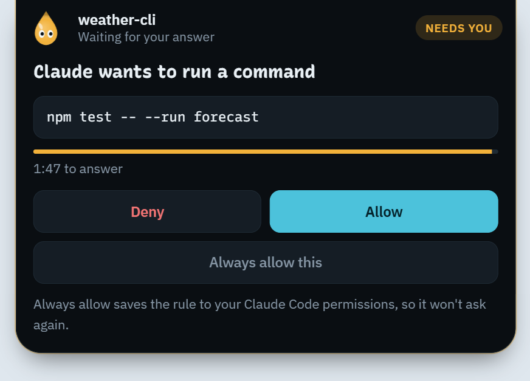
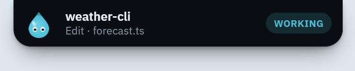
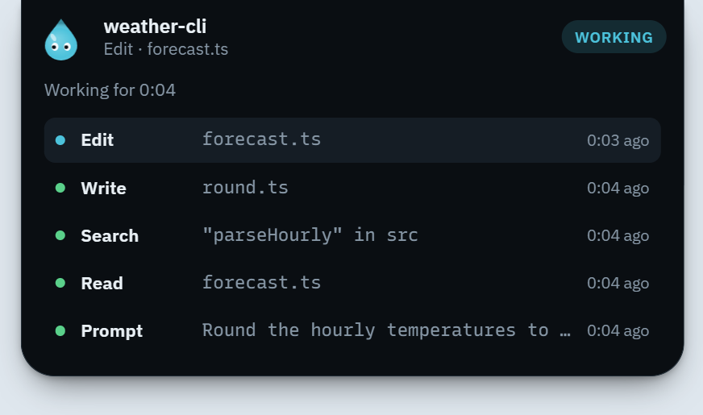
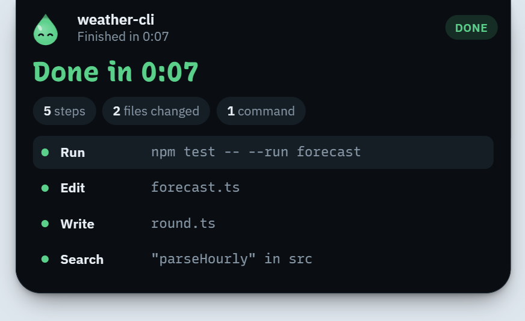

# Drip

A small Windows companion for Claude Code that hangs from the top of your screen, shows what your sessions are doing, and lets you approve or deny permission requests without going back to the terminal.

<p align="center">
  
</p>

| Working | Activity | Done |
| :-: | :-: | :-: |
|  |  |  |

## What it does

Drip is a dark "island" centred at the top edge of your primary monitor. It stays out of the way until something happens:

- **Shows activity.** When a session starts, the island drops down as a small pill with the project name and the current step. Click it to see the recent steps: prompts, files read and edited, searches, commands, each marked running, done or failed.
- **Asks you for permission.** When Claude Code wants to run something that needs your OK, the island opens with the command, a countdown, and **Deny**, **Allow** and **Always allow this**. Always allow saves the same rule Claude Code would offer in the terminal, so it won't ask again.
- **Reports the end of a turn.** Green when Claude finishes, with a short summary; red with the error when a turn fails.
- **Gets out of the way.** Hover the very top-centre edge of the screen to wake it, click to cycle peek → compact → expanded, press Esc to collapse it. The window is only as big as the island, so it never blocks clicks elsewhere.

Claude Code still shows its own prompt in the terminal at the same time, so you can answer either place. Several sessions can ask at once: their cards wait in line. Questions (`AskUserQuestion`) and plan reviews (`ExitPlanMode`) can't be answered with Allow/Deny, so they stay in the terminal.

## Install

There is no signed release yet. Build the installer from source (below) and run `Drip_<version>_x64-setup.exe`.

> **The installer is not code-signed.** Windows SmartScreen will warn that it's from an unknown publisher. Choose **More info → Run anyway** if you built it yourself or trust where it came from. It installs per user, with no admin rights needed.

Then, from Drip's icon in the notification area:

1. **Install Claude Code hooks…** shows the exact change to `%USERPROFILE%\.claude\settings.json` (or `settings.json` in `CLAUDE_CONFIG_DIR` if you set it), and writes only when you click **Back up and install**. It takes a timestamped backup first, keeps all your settings and hooks, and copies the relay to `%LOCALAPPDATA%\Drip\bin\drip-hook.exe`.
2. Start Claude Code. Drip wakes on the next event.

**Uninstall hooks** removes only the entries that run `drip-hook.exe`, again with a preview and a backup. The same previews open from the command line with `Drip.exe --install-hooks` and `Drip.exe --uninstall-hooks`.

## Build from source

Requirements: Windows 10 or 11, Node.js 20+, Rust (stable, MSVC toolchain), and Visual Studio Build Tools with the **Desktop development with C++** workload.

```
npm install
npm run tauri dev      # run with hot reload; dev builds start on a sample session
npm run tauri build    # installer in target\release\bundle\nsis\
```

Both commands build `drip-hook.exe` first (`npm run hook`). `npm run icons` redraws the app icons from the droplet code. `cargo test --workspace` runs the Rust tests.

To try the island without Claude Code, start `npm run tauri dev` and pipe a sample event into the relay from PowerShell:

```powershell
Get-Content samples\session-start.json | target\release\drip-hook.exe
Get-Content samples\permission-request.json | target\release\drip-hook.exe   # waits for your click
```

### Recording a GIF

The screenshots above are stills. To record the island in motion, use [ScreenToGif](https://www.screentogif.com/) (free) or ShareX's GIF recorder:

1. Run `npm run tauri dev` and wait for the island to settle.
2. Draw the recording area around the top-centre of your primary screen, about 520 × 380 px at 100% scaling (scale it up for higher DPI). Clear the desktop behind it, since the island is transparent around its edges.
3. Start recording, then pipe the samples in order with a short pause between each: `session-start`, `user-prompt-submit`, `pre-tool-use`, `post-tool-use`, `permission-request` (click **Allow** on the island), `stop`.
4. Trim, save as `docs/drip.gif`, and swap it in for the approval screenshot at the top of this file.

## How it works

```
Claude Code ──hook JSON──▶ drip-hook.exe ──\\.\pipe\drip-<your SID>──▶ Drip ──▶ island
            ◀──decision───               ◀── allow / always / deny ────────── your click
```

`drip-hook.exe` is the command Claude Code runs for each hook event. It hands the event to the Drip app over a named pipe. The app turns Claude Code's payload into a small agent-neutral event (`src-tauri/src/agents/`) and shows it. For a permission request, the relay waits for your answer and prints Claude Code's documented decision JSON.

## How it was built

Edima Essien designed Drip as a browser prototype, [docs/prototype.html](docs/prototype.html) (the island, the droplet character, and every mode and view), and wrote the build spec, [docs/build-spec.md](docs/build-spec.md). The spec refers to the prototype by its original name, `drip.html`.

The app was then built with Claude Code from that spec, milestone by milestone, with tests at each step: the island and its modes, the relay and pipe, the permission round trip, the hook installer, and finally real Claude Code sessions. Each milestone is a commit in this repository's history.

## Security

Drip runs on every Claude Code hook event, so it's built to be predictable and to fail safe.

**What `drip-hook.exe` does.** It reads the hook's JSON from stdin, drops `tool_response` and `transcript_path`, caps long strings, and sends one line to `\\.\pipe\drip-<your SID>`. Before sending anything it checks that the process serving the pipe runs as your Windows account, so another user on the same machine can't impersonate Drip and read your events. For a permission request it waits for one word back and prints the matching decision.

**What it can't do.** It makes no network connections, runs no commands, and writes no files. The only output that can change what Claude Code does is a permission decision, and the app sends one only after you click a button. A decision can only allow or deny the request as it stands: Drip never edits the command or its input (`updatedInput`), and **Always allow** only passes back the permission rules Claude Code itself suggested for that request.

**How it fails safe.** Whatever goes wrong, the relay exits with code 0 and Claude Code carries on as if Drip weren't installed:

- Drip not running: the connection fails at once (within 300 ms at most) and the relay prints nothing.
- Drip slow or stuck: events are abandoned after 2 s; a permission request after 110 s, and the app lets go first at 108 s.
- Drip crashes while you're deciding, the reply is anything other than `allow`, `always` or `deny`, or you don't answer: nothing is printed, and Claude Code asks in the terminal as usual.

On the app side, the pipe takes at most 1 MB per event. The approval buttons ignore presses in a card's first 400 ms and count a click only if it started on that same button, so a double-click can't answer the next card. Editing `settings.json` always goes through a preview, a backup, and a check that the file hasn't changed since the preview.

**What stays on your machine.** Hook events include your prompts, file paths and commands. Drip only shows them on the island and keeps them in memory while it runs. It writes no log files, has no telemetry, and makes no network requests. The only files it writes are `settings.json`, its backups, and the copy of `drip-hook.exe`, and only when you install or uninstall the hooks. (WebView2, the browser engine the island runs in, keeps its own cache folder under `%LOCALAPPDATA%\app.drip.companion`; Drip stores nothing there.)

Drip prints a few diagnostic lines to stderr, which you only see if you start it from a terminal (release builds have no console): one line per answered card, `[drip] decision id=<n> choice=<allow|always|deny|ask>`, and error messages if it can't open its pipe or copy `drip-hook.exe`. Those error messages can include Drip's own paths and the pipe name, which contains your Windows account SID. None of these lines contains a prompt, a command or a path from a hook event.

**Review.** The whole codebase (30 source files) went through Claude Code's multi-agent `/code-review ultra`. It found no correctness or security issues; its single finding, a typo in the `npm run icons` script, is fixed.

## Limitations

- Windows 10 and 11 only.
- The island follows one session at a time (whichever spoke last) and the end-of-turn summary counts steps from every session together.
- No Chat tab yet; the prototype's chat is hidden in this version.

## Credits

Drip's relay, named-pipe server and settings merge adapt code patterns from [coucou](https://github.com/louis-cfm/coucou) by Louis Raillé (MIT). Drip doesn't use coucou's name, its Mochi character, icons, sounds or other media. See [THIRD_PARTY_NOTICES.md](THIRD_PARTY_NOTICES.md).

Fonts: Recursive and IBM Plex Sans, bundled through Fontsource (SIL Open Font License 1.1).

## License

MIT. See [LICENSE](LICENSE).
